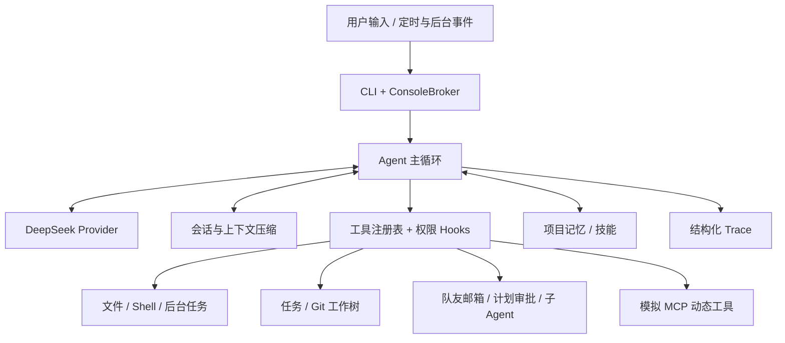

# DeepSeek Agent Harness

一个基于 DeepSeek 的模块化代码 Agent。项目实现模型与工具的多轮闭环，并将任务管理、团队协作、上下文压缩、项目记忆、定时任务和权限控制组合在同一个本地工作台中。

> 状态：可运行的本地项目与工程实践展示。Shell 在用户机器上执行；MCP 的 docs/deploy 是进程内模拟服务，尚未接入远程 MCP 协议。

## 功能亮点

- **模型工具闭环**：基于 DeepSeek Chat Completions 处理 `tool_calls`、`tool_call_id` 和思考模式的 `reasoning_content`；限制轮数并处理重试、长响应和上下文超限。
- **可控工具执行**：文件读取、写入、精确替换、文件搜索与 Shell 命令；路径边界、命令超时、权限确认和生命周期 Hook。
- **任务与多 Agent 协作**：持久任务、依赖关系、Git 工作树绑定；队友通过文件邮箱通信，支持计划审批、消息发送和正常退出。
- **异步与调度**：后台命令完成后向 Agent 投递通知；支持一次性或循环、会话级或持久化的五字段 cron 请求。
- **上下文与记忆**：大工具输出落盘、分层历史压缩；分类 Markdown 记忆、索引、相关记录选择、自动提取与合并。
- **可观测性**：JSONL trace 记录模型用量与工具事件，不写入 API 密钥和完整提示词。

## 架构



模块职责与关键设计见 [架构文档](docs/architecture.md)。

## 快速开始

需要 Python 3.11+ 和 DeepSeek API Key。以下命令适用于 Windows PowerShell：

```powershell
py -3.11 -m venv .venv
& '.\.venv\Scripts\python.exe' -m pip install -r requirements.txt
Copy-Item .env.example .env
# 编辑 .env，填入 DEEPSEEK_API_KEY
& '.\.venv\Scripts\python.exe' run.py
```

已有 `.env` 时不要覆盖。Linux/macOS 可使用 `python3 -m venv .venv`、`.venv/bin/python` 和 `cp .env.example .env`。

单次请求：

```powershell
& '.\.venv\Scripts\python.exe' run.py --prompt "列出当前项目的 Python 文件，并说明入口模块"
```

交互模式输入 `/exit` 退出。团队、后台通知和定时唤醒需要保持交互进程运行。Shell 命令、模拟部署触发和队友创建会要求确认；只在可信工作区授权执行。`--workspace` 可以指定另一个工作目录。

## 演示场景

1. 让 Agent 列出代码文件并说明模块职责，展示模型与 `glob`、`read_file` 的工具闭环。
2. 创建有依赖的任务，认领任务并绑定 Git 工作树，展示任务状态和隔离工作目录。
3. 启动队友并要求先提交计划，由主 Agent 审批后继续，展示邮箱与人工介入流程。
4. 使用 `connect_mcp` 连接 `docs`，再调用动态发现的 `mcp__docs__search`。该服务为模拟实现。

## 测试

```powershell
& '.\.venv\Scripts\python.exe' -m pip install -r requirements-dev.txt
& '.\.venv\Scripts\python.exe' -m pytest -q
```

测试覆盖模型工具消息、团队计划审批、邮箱、任务与工作树、模拟 MCP、后台通知、上下文压缩、记忆和 cron 投递。`scripts/live_team_smoke.py` 提供可选的真实 API 冒烟测试，会产生 API 费用。

## 安全与当前边界

- `.env`、运行记录、项目记忆、邮箱与工作树由 `.gitignore` 排除；请勿将真实密钥写入代码或测试。
- Shell 使用本机用户权限，没有容器级沙箱。异步轮次无法弹出确认时，敏感工具调用会被拒绝。
- 活跃队友线程和后台进程只存在于当前 CLI 进程；持久邮箱与定时任务保存在磁盘。
- docs/deploy 是模拟 MCP 工具。若用于远程服务，需要实现真实 MCP 连接、认证与生命周期管理。
- 当前测试验证关键功能路径；尚无跨任务完成率、延迟和 token 成本的系统评测。

## 技术栈

Python 3.11+ · OpenAI Python SDK（DeepSeek 兼容接口）· PyYAML · pytest · Git Worktree
