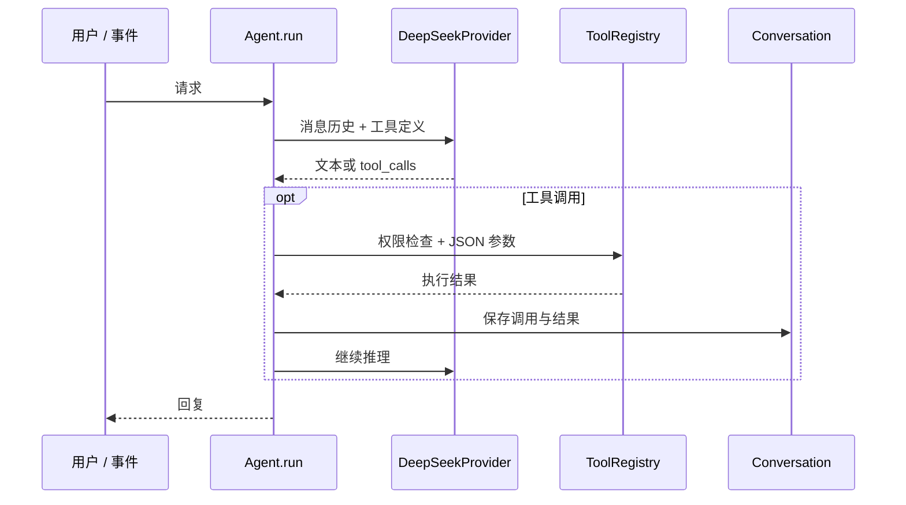

# 架构设计

## 请求执行链

`cli.py` 接收用户输入或异步事件，交给 `Agent.run`。主循环组装系统上下文和工具定义，调用 DeepSeek；模型返回文本时结束当前轮次，返回 `tool_calls` 时由注册表校验参数并执行，再以对应的 `tool_call_id` 回传结果。整个过程有模型调用次数上限。

## 模块边界

| 模块 | 职责 |
| --- | --- |
| `config.py` | 环境变量、模型与运行参数校验 |
| `provider.py` | DeepSeek Chat Completions 请求、工具消息转换、重试与回退模型 |
| `agent.py` | 主循环、工具装配、事件注入与轮数控制 |
| `tools.py`, `shell.py`, `background.py` | 工作区工具、进程超时、异步命令与完成通知 |
| `hooks.py` | 权限策略及工具执行前后回调 |
| `context.py` | 会话保存、大输出落盘、分层压缩与模型摘要 |
| `tasks.py`, `locking.py`, `worktrees.py` | 持久任务、跨进程锁、依赖 DAG 和任务绑定工作树 |
| `team.py`, `subagents.py` | 队友邮箱、任务认领、计划审批、正常退出与有界子任务 |
| `memory.py`, `skills.py` | 分类项目记忆、相关记录选择和本地技能读取 |
| `scheduler.py` | cron 匹配、持久投递、确认及恢复 |
| `mcp.py` | 进程内模拟服务的延迟连接、工具发现和主机策略 |
| `telemetry.py`, `console.py`, `cli.py` | 运行记录、输入仲裁与交互入口 |

## 关键工程决策

**模型协议隔离。** Provider 将 SDK 返回值转换成 `ModelReply`。DeepSeek 工具调用使用 `assistant.tool_calls` 和 `role=tool`；思考模式下保留 `reasoning_content`，使下一轮工具消息具备完整上下文。业务模块不直接依赖 SDK 类型。

**工具结果与上下文。** 工具输出过长时完整内容写入 `.harness/tool-results/`，模型只接收路径和预览。历史压缩优先缩短旧工具结果，再按完整用户轮次裁剪；必要时让模型生成事实摘要，同时保留当前请求。

**任务一致性。** 任务依赖写入前检查环。Windows/POSIX 文件锁串行化跨进程修改；任务文件经临时文件原子替换。工作树操作验证 Git 注册状态，移除前检查未提交改动及活跃使用者。

**人工介入。** Shell、敏感模拟 MCP 操作和队友启动经过权限 Hook。计划审批消息带请求 ID、任务 ID 和版本，过期回应不会解锁当前队友任务。异步线程无法获得交互确认时拒绝敏感操作。

**持久化边界。** 任务、记忆、定时请求和邮箱写入本地文件；活跃线程与后台进程不跨 CLI 重启恢复。定时任务采用确认投递，并在重启后恢复未确认的持久任务；多进程调度尚无分布式事务保证。

## 可扩展方向

若面向生产环境，可将 Shell 放入容器沙箱，以数据库事务统一管理任务和投递状态，接入真实 MCP 协议，并建立任务级评测集追踪完成率、耗时与 token 成本。
